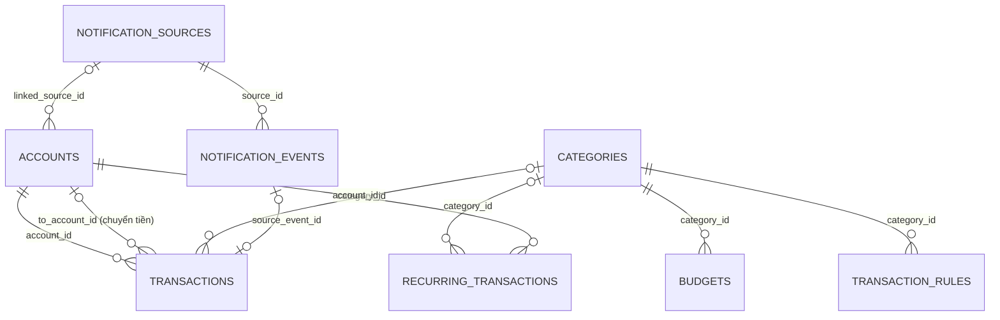

# DATABASE — Room (SQLite)

Tài liệu cho **Codex**. Chưa phải code. Chi tiết nào đánh dấu **[ĐỀ XUẤT]** hoặc **[CẦN XÁC MINH]** thì chưa phải yêu cầu cố định (xem `AGENTS.md` mục 3.5 và `docs/agents/DECISIONS.md`).

## 1. Quy ước chung

- Khoá chính: `id INTEGER`, tự tăng, trừ khi ghi khác.
- **Tiền: `INTEGER` (Long), đơn vị đồng VND.** Cấm `REAL`/`Double`/`Float` cho tiền.
- Thời gian: `INTEGER` epoch milliseconds, UTC.
- Enum lưu dạng `TEXT` (tên enum), có ràng buộc `CHECK` hoặc kiểm tra ở tầng mapper. Không lưu số thứ tự, để tránh vỡ khi đổi thứ tự enum.
- Cột `created_at`, `updated_at` có ở mọi bảng nghiệp vụ.
- Bật `PRAGMA foreign_keys = ON` (Room mặc định bật).
- Export schema JSON của Room vào repo, viết **migration test** cho mọi lần đổi phiên bản.
- Phiên bản schema ban đầu: `1`.

## 2. Sơ đồ quan hệ

## 3. Bảng

### 3.1 `accounts`

| Cột | Kiểu | Null | Ghi chú |
|---|---|---|---|
| id | INTEGER PK | | |
| name | TEXT | | Duy nhất trong các tài khoản chưa lưu trữ |
| type | TEXT | | `CASH` / `BANK` / `EWALLET` |
| initial_balance | INTEGER | | Số dư ban đầu (đồng), có thể âm nếu cần [ĐỀ XUẤT: cho phép] |
| linked_source_id | INTEGER FK | ✔ | → `notification_sources.id`, `ON DELETE SET NULL`. Dùng để gán tài khoản cho giao dịch tự động |
| is_archived | INTEGER | | 0/1 |
| created_at, updated_at | INTEGER | | |

Index: `(type)`, `(linked_source_id)`.

### 3.2 `categories`

| Cột | Kiểu | Null | Ghi chú |
|---|---|---|---|
| id | INTEGER PK | | |
| name | TEXT | | |
| type | TEXT | | `INCOME` / `EXPENSE` |
| icon_key | TEXT | | Khoá icon trong `:ui`, không lưu tài nguyên |
| color_key | TEXT | | Khoá màu |
| is_system | INTEGER | | 1 = danh mục mặc định, không cho xoá |
| is_archived | INTEGER | | |
| sort_order | INTEGER | | |
| created_at, updated_at | INTEGER | | |

Unique: `(name, type)`. Seed danh mục mặc định ở lần tạo DB đầu tiên *(danh sách cụ thể: [ĐỀ XUẤT] ở Phase 2)*.

### 3.3 `transactions`

| Cột | Kiểu | Null | Ghi chú |
|---|---|---|---|
| id | INTEGER PK | | |
| account_id | INTEGER FK | | → `accounts.id`, `ON DELETE RESTRICT` |
| to_account_id | INTEGER FK | ✔ | Chỉ dùng cho `TRANSFER`. → `accounts.id`, `RESTRICT` |
| category_id | INTEGER FK | ✔ | → `categories.id`, `ON DELETE SET NULL` |
| type | TEXT | | `INCOME` / `EXPENSE` / `TRANSFER` / `REFUND` / `ADJUSTMENT` |
| amount | INTEGER | | Đồng. `> 0` với mọi loại **trừ** `ADJUSTMENT` (có thể âm, khác 0) |
| note | TEXT | | Mặc định rỗng |
| occurred_at | INTEGER | | Thời điểm giao dịch |
| status | TEXT | | `AUTO_RECORDED` / `USER_CONFIRMED` / `NEEDS_REVIEW` / `REJECTED` |
| origin | TEXT | | `MANUAL` / `NOTIFICATION` |
| source_event_id | INTEGER FK | ✔ | → `notification_events.id`, `SET NULL` |
| dedup_key | TEXT | ✔ | Khoá chống trùng cho giao dịch từ thông báo |
| created_at, updated_at | INTEGER | | |

Ràng buộc nghiệp vụ (kiểm tra ở domain/mapper, và `CHECK` nếu khả thi):
- `TRANSFER` bắt buộc có `to_account_id` khác `account_id`. Các loại khác thì `to_account_id` là NULL.
- `origin = MANUAL` thì `status = USER_CONFIRMED`.

Index: `(occurred_at)`, `(account_id, occurred_at)`, `(category_id, occurred_at)`, `(status)`, `UNIQUE (dedup_key)` (cho phép nhiều NULL).

### 3.4 `budgets`

| Cột | Kiểu | Null | Ghi chú |
|---|---|---|---|
| id | INTEGER PK | | |
| category_id | INTEGER FK | | → `categories.id`, `ON DELETE CASCADE` |
| month | INTEGER | | Dạng `yyyyMM`, ví dụ `202611` |
| limit_amount | INTEGER | | Đồng, `> 0` |
| warn_threshold_percent | INTEGER | | Mặc định 80 [ĐỀ XUẤT] |
| created_at, updated_at | INTEGER | | |

Unique: `(category_id, month)`.

### 3.5 `notification_sources`

| Cột | Kiểu | Null | Ghi chú |
|---|---|---|---|
| id | INTEGER PK | | |
| package_name | TEXT | | UNIQUE. **[CẦN XÁC MINH]** giá trị thật của MoMo/BIDV trên máy thật |
| display_name | TEXT | | |
| parser_id | TEXT | | Khoá để chọn parser tương ứng |
| is_enabled | INTEGER | | Người dùng bật/tắt. Mặc định 0 cho tới khi người dùng chọn |
| created_at, updated_at | INTEGER | | |

### 3.6 `notification_events`

Nhật ký xử lý thông báo, **không phải bản sao thông báo**. Xem `docs/NOTIFICATION_PARSING.md` mục 7.

| Cột | Kiểu | Null | Ghi chú |
|---|---|---|---|
| id | INTEGER PK | | |
| source_id | INTEGER FK | | → `notification_sources.id`, `CASCADE` |
| posted_at | INTEGER | | Thời điểm thông báo đến |
| fingerprint | TEXT | | Hash chống trùng, **không** đảo ngược được thành nội dung |
| classification | TEXT | | `TRANSACTION_SUCCESS` / `TRANSACTION_FAILED` / `PROMO` / `UNKNOWN` (**không có `OTP`**: OTP không lưu) |
| parse_status | TEXT | | `PARSED` / `PARSE_FAILED` / `IGNORED` |
| parser_version | INTEGER | | Để biết sự kiện cũ do bản parser nào xử lý |
| redacted_text | TEXT | ✔ | Bản đã che số tài khoản, tên, số dư. NULL nếu không cần lưu |
| expires_at | INTEGER | | Hết hạn thì xoá `redacted_text` và có thể xoá cả dòng [ĐỀ XUẤT: 30 ngày] |
| created_at | INTEGER | | |

Index: `UNIQUE (source_id, fingerprint)`, `(posted_at)`, `(expires_at)`.

### 3.7 `transaction_rules`

Quy tắc đề xuất danh mục theo nội dung. Dạng so khớp đơn giản, không dùng máy học.

| Cột | Kiểu | Null | Ghi chú |
|---|---|---|---|
| id | INTEGER PK | | |
| match_type | TEXT | | `CONTAINS` / `STARTS_WITH` [ĐỀ XUẤT: chưa hỗ trợ regex cho người dùng] |
| pattern | TEXT | | Chuẩn hoá chữ thường, bỏ dấu khi so khớp |
| category_id | INTEGER FK | | → `categories.id`, `CASCADE` |
| priority | INTEGER | | Số nhỏ ưu tiên trước |
| is_enabled | INTEGER | | |
| created_at, updated_at | INTEGER | | |

Index: `(is_enabled, priority)`.

### 3.8 `recurring_transactions`

Chỉ để **nhắc nhở**. Không tự tạo giao dịch, không thực hiện thanh toán.

| Cột | Kiểu | Null | Ghi chú |
|---|---|---|---|
| id | INTEGER PK | | |
| name | TEXT | | |
| type | TEXT | | `INCOME` / `EXPENSE` |
| amount | INTEGER | ✔ | Có thể chưa biết trước |
| account_id | INTEGER FK | | → `accounts.id`, `CASCADE` |
| category_id | INTEGER FK | ✔ | `SET NULL` |
| frequency | TEXT | | `WEEKLY` / `MONTHLY` / `YEARLY` [ĐỀ XUẤT] |
| day_rule | INTEGER | | Thứ trong tuần hoặc ngày trong tháng, tuỳ `frequency` |
| next_due_at | INTEGER | | |
| remind_before_days | INTEGER | | Mặc định 1 [ĐỀ XUẤT] |
| is_active | INTEGER | | |
| created_at, updated_at | INTEGER | | |

Index: `(is_active, next_due_at)`.

### 3.9 `backup_metadata`

| Cột | Kiểu | Null | Ghi chú |
|---|---|---|---|
| id | INTEGER PK | | |
| created_at | INTEGER | | |
| app_version | TEXT | | |
| db_schema_version | INTEGER | | Dùng để quyết định có khôi phục được không |
| file_name | TEXT | | |
| size_bytes | INTEGER | | |
| checksum | TEXT | | |
| is_encrypted | INTEGER | | |

### 3.10 Không tạo ở v1

- `app_settings`: dùng DataStore (xem `DECISIONS.md` D-006).
- `savings_goals`, `savings_contributions`: **[ĐỀ XUẤT]**, chờ Khoa xác nhận D-003. Nếu duyệt, thiết kế lại ở Phase 4.

## 4. Cách tính số dư ước tính [ĐỀ XUẤT, xem D-005]

Với mỗi tài khoản: `initial_balance` + tổng tác động của các giao dịch có `status` là `AUTO_RECORDED` hoặc `USER_CONFIRMED`:

| Loại | Tác động |
|---|---|
| INCOME | `+amount` lên `account_id` |
| EXPENSE | `−amount` lên `account_id` |
| TRANSFER | `−amount` lên `account_id`, `+amount` lên `to_account_id` |
| REFUND | `+amount` lên `account_id` |
| ADJUSTMENT | `+amount` (có dấu) lên `account_id` |

Số dư luôn là **ước tính**. Tính bằng truy vấn tổng hợp, **không** lưu cột số dư để tránh lệch. Nếu hiệu năng cần, xem xét lại sau và ghi vào `DECISIONS.md`.

Cách `REFUND` ảnh hưởng thống kê theo danh mục (trừ vào chi tiêu hay tính riêng): **[CẦN XÁC MINH]** với Khoa.

## 5. Xoá và lưu trữ

- Tài khoản, danh mục: **lưu trữ** (`is_archived`) thay vì xoá nếu đã có giao dịch (`RESTRICT` ngăn xoá cứng).
- Giao dịch: xoá cứng, có xác nhận ở UI. Cân nhắc hoàn tác ngắn hạn ở UI **[ĐỀ XUẤT]**.
- "Xoá toàn bộ dữ liệu": xoá mọi bảng, DataStore, file backup cục bộ và khoá liên quan.

## 6. Việc cần test (Codex)

- DAO với Room in-memory: CRUD, ràng buộc FK, unique `dedup_key`.
- Tính số dư theo từng loại giao dịch và từng trạng thái.
- Migration từ mỗi phiên bản cũ.
- Dọn `notification_events` hết hạn.
