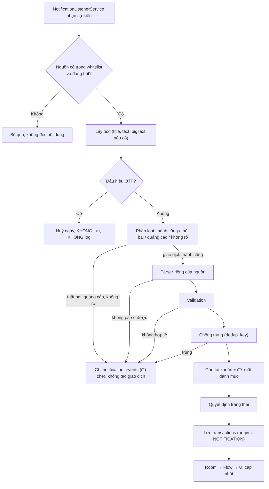

# NOTIFICATION PARSING

Tài liệu cho **Codex**. Chưa phải code.

> **Chưa có mẫu thông báo thật của MoMo hay BIDV.** Tài liệu này mô tả quy trình và cách kiểm thử, **không** mô tả định dạng cụ thể của bất kỳ ngân hàng nào. Không được đoán định dạng. Parser chỉ được viết sau khi có fixture thật (mục 8).

## 1. Quy trình



## 2. Phân loại và thứ tự kiểm tra

Thứ tự **cố định**, kiểm tra OTP trước nhất:

1. **OTP**: huỷ ngay. Danh sách dấu hiệu nhận diện do từng nguồn khai báo, kèm một bộ dấu hiệu chung. **[CẦN XÁC MINH]** bằng mẫu thật.
2. **Quảng cáo / khuyến mãi**.
3. **Giao dịch thất bại**.
4. **Giao dịch thành công** → chuyển sang parser.
5. Còn lại: `UNKNOWN`. Không tạo giao dịch.

Khi nghi ngờ giữa "thành công" và loại khác, **chọn không tạo giao dịch** (an toàn hơn tạo giao dịch sai).

## 3. Parser theo từng nguồn

- Mỗi nguồn có **parser riêng**, chọn qua `notification_sources.parser_id`. Không dùng một regex chung cho mọi ngân hàng.
- Parser là hàm thuần: nhận nội dung thông báo, trả về một trong ba kết quả: *đã parse* (kèm trường dữ liệu), *không parse được*, *bỏ qua*. Không phụ thuộc Android để test được bằng JUnit thường.
- Thêm nguồn mới = thêm một parser + whitelist + fixture. Không sửa parser cũ.
- Có `parser_version`. Khi sửa parser, tăng phiên bản.

Trường cần trích:

| Trường | Bắt buộc | Ghi chú |
|---|---|---|
| Số tiền | Có | Chuẩn hoá về `Long` đồng. Phải xử lý dấu phân cách nghìn và hậu tố tiền tệ như xuất hiện trong mẫu thật |
| Chiều giao dịch (thu/chi) | Có | Suy ra từ từ khoá của nguồn đó |
| Nội dung / ghi chú | Không | |
| Thời gian giao dịch | Không | Nếu thông báo không có thì dùng thời điểm `posted_at` |
| Tên đối tác, số dư sau giao dịch | Không | Nếu lấy, chỉ để hiển thị, **không** dùng để tính số dư EasyCash (số dư của EasyCash là ước tính từ giao dịch đã ghi) |

## 4. Quyết định trạng thái [ĐỀ XUẤT]

| Tình huống | Kết quả |
|---|---|
| Có đủ số tiền + chiều, parser tin cậy, không nghi trùng | Tạo giao dịch `AUTO_RECORDED` |
| Có số tiền nhưng chiều không rõ, hoặc nghi trùng/chuyển nội bộ, hoặc thông báo bị rút gọn | Tạo giao dịch `NEEDS_REVIEW` |
| Không có số tiền | **Không** tạo giao dịch, chỉ ghi `notification_events` |
| Người dùng từ chối | `REJECTED` (giữ để không tạo lại, không tính vào số dư) |
| Người dùng xác nhận/sửa | `USER_CONFIRMED` |

Giao dịch từ thông báo **không phải dữ liệu đã xác minh từ ngân hàng**. UI phải thể hiện nguồn "tự động".

## 5. Chống trùng

Một giao dịch có thể sinh nhiều sự kiện (thông báo cập nhật lại, hoặc cả app ngân hàng và ví cùng báo).

- **Trùng cùng nguồn:** `fingerprint` = hash của (nguồn + nội dung đã chuẩn hoá + thời điểm làm tròn) **[ĐỀ XUẤT]**, ràng buộc `UNIQUE (source_id, fingerprint)`.
- **`dedup_key` của giao dịch:** dựng từ các trường đã parse (nguồn, số tiền, chiều, thời gian, mã tham chiếu nếu thông báo có). `UNIQUE`.
- **Trùng giữa hai nguồn / chuyển tiền nội bộ:** không tự gộp. Phát hiện cặp (cùng số tiền, ngược chiều, hai tài khoản khác nhau, trong cửa sổ thời gian ngắn) rồi **chỉ gợi ý** cho người dùng (`NEEDS_REVIEW`). Độ dài cửa sổ: **[CẦN XÁC MINH]** bằng mẫu thật. Xem `DECISIONS.md` D-008.
- Phải có test cho: cùng thông báo đến hai lần, thông báo cập nhật nội dung, hai nguồn báo cùng một khoản.

## 6. Giới hạn cần thiết kế quanh nó

- Chỉ nhận được thông báo **từ lúc cấp quyền trở đi**. Không có lịch sử cũ.
- Ngân hàng không gửi thông báo, hoặc người dùng tắt thông báo của app đó, thì không có dữ liệu.
- Thông báo có thể bị ẩn/rút gọn. Cố đọc nội dung mở rộng nếu hệ thống cung cấp, nếu vẫn thiếu thì xử lý theo mục 4.
- Hệ điều hành/hãng máy có thể ngắt hoặc không rebind listener: cần cơ chế phát hiện và báo trạng thái cho UI. **[CẦN XÁC MINH]** trên máy thật.

## 7. Riêng tư khi xử lý

- Không ghi nội dung thông báo, số tiền, số tài khoản ra Logcat ở bất kỳ build nào.
- `notification_events` lưu `fingerprint` và bản **đã che** (số tài khoản, tên, số dư). Thông báo OTP không lưu gì.
- `redacted_text` có hạn dùng (mặc định 30 ngày **[ĐỀ XUẤT]**), dọn bằng WorkManager.
- Hàm che dữ liệu phải có test riêng.
- Người dùng tắt một nguồn thì ngừng xử lý ngay thông báo của nguồn đó.

## 8. Fixture: cách thu thập và dùng

**Khoa cung cấp** mẫu thông báo thật của MoMo và BIDV. Mỗi nguồn cần càng đủ loại càng tốt:

- Nhận tiền, chi tiền / thanh toán, chuyển khoản đi, hoàn tiền.
- Giao dịch thất bại.
- Quảng cáo / khuyến mãi.
- OTP (để kiểm tra bộ lọc OTP huỷ đúng; **không đưa OTP thật vào repo**, thay bằng số giả cùng định dạng).
- Thông báo bị rút gọn.

**Che dữ liệu trước khi đưa vào repo:** thay số tài khoản, tên người, số điện thoại, mã tham chiếu thật bằng giá trị giả giữ nguyên định dạng. Giữ nguyên cấu trúc câu, dấu phân cách, hậu tố tiền tệ. **Không commit mẫu chưa che.**

Vị trí và định dạng gợi ý:

```
data/src/test/resources/notifications/<nguồn>/<số>-<nhãn>.txt
```

```
# package: <package name thật, CẦN XÁC MINH>
# title: <tiêu đề thông báo>
# text: <nội dung>
# bigText: <nội dung mở rộng, nếu có>
# expect.classification: TRANSACTION_SUCCESS
# expect.direction: INCOME
# expect.amount: 150000
# expect.note: <nếu có>
```

Mỗi fixture là một test case tự động. Sửa parser mà làm hỏng fixture cũ thì phải giải thích.

*[ĐỀ XUẤT]* Một màn hình chỉ có ở bản debug để chụp nhanh nội dung thông báo thành fixture. Chưa phải yêu cầu, chỉ làm khi Khoa duyệt.

## 9. Việc còn mở

| Mục | Trạng thái |
|---|---|
| Package name thật của MoMo, BIDV | CẦN XÁC MINH |
| Định dạng thông báo từng loại giao dịch | CẦN XÁC MINH (cần mẫu thật) |
| Dấu hiệu OTP của từng nguồn | CẦN XÁC MINH |
| Cửa sổ thời gian ghép chuyển tiền nội bộ | CẦN XÁC MINH |
| Hành vi listener trên các hãng máy | CẦN XÁC MINH (máy thật) |
| Cấp quyền cho APK cài ngoài Store trên Android 13+ | CẦN XÁC MINH (máy thật), xem spec mục 16 |
