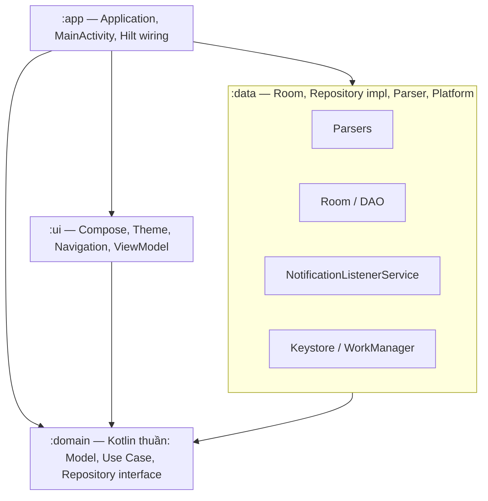
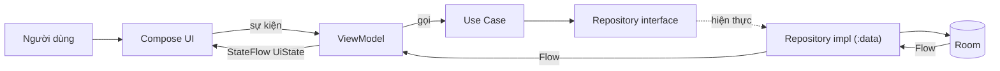
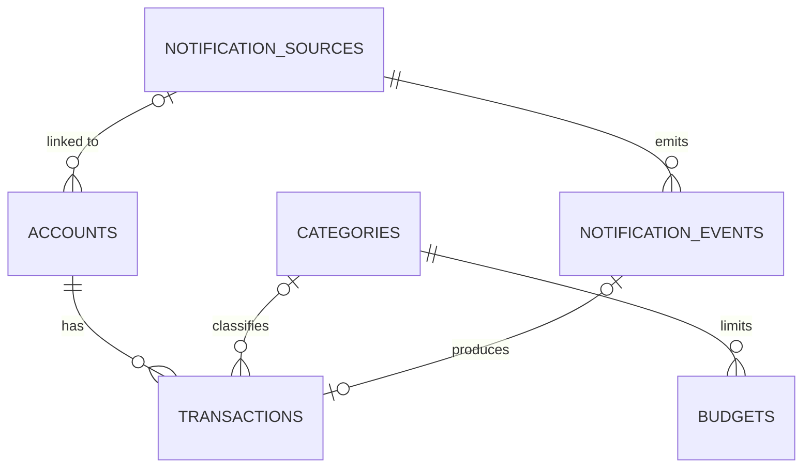
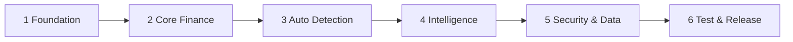

# EasyCash — PROJECT SPECIFICATION

**EasyCash – Personal Finance Manager**
Phiên bản tài liệu: 1.0 (2026-11-20) · Trạng thái: nguồn tham chiếu chính thức cho các AI Coding Agent.

> **Cách đọc tài liệu này**
> - Tài liệu này **chưa chứa code triển khai**.
> - **Required**: yêu cầu đã xác định trong yêu cầu gốc của Khoa. **Proposed**: đề xuất, chưa bắt buộc, không triển khai khi chưa được duyệt.
> - **[CẦN XÁC MINH]**: chưa chắc, phải kiểm chứng (máy thật / tài liệu chính thức) trước khi dựa vào.
> - **[ĐỀ XUẤT]**: gợi ý, chưa phải yêu cầu.
> - Quyết định kiến trúc đã chốt và còn chờ duyệt: `docs/agents/DECISIONS.md`.
> - Chi tiết kỹ thuật: `docs/DATABASE.md`, `docs/NOTIFICATION_PARSING.md`, `docs/UI_UX.md`. Luật làm việc của agent: `AGENTS.md`.

---

## 1. Project Overview

EasyCash là ứng dụng Android quản lý tài chính cá nhân: theo dõi thu nhập, chi tiêu, quản lý nhiều tài khoản ngân hàng và ví điện tử trên cùng một nền tảng.

Điểm nổi bật: **tự động nhận diện giao dịch mới** từ thông báo của các ứng dụng ngân hàng và ví điện tử mà người dùng chủ động cấp quyền, phân tích rồi lưu trực tiếp vào thiết bị.

Định hướng phát triển: **Offline-first** và **Privacy-first**. Phiên bản đầu tiên:
- Không bắt buộc đăng nhập.
- Không yêu cầu mật khẩu ngân hàng hoặc OTP.
- Không gửi dữ liệu tài chính lên Cloud.

## 2. Product Vision & Goals

**Tầm nhìn:** một nơi duy nhất để người dùng thấy dòng tiền của mình, với dữ liệu nằm hoàn toàn trên thiết bị của họ và công sức nhập liệu thấp nhất có thể.

**Mục tiêu v1**
1. Quản lý thu/chi và nhiều tài khoản thủ công đầy đủ, dùng tốt khi không có mạng.
2. Tự ghi nhận giao dịch từ thông báo của **MoMo** và **BIDV**, có kiến trúc mở rộng cho nguồn khác.
3. Giúp người dùng hiểu chi tiêu: ngân sách, thống kê, báo cáo.
4. Bảo vệ dữ liệu: khoá ứng dụng, sao lưu mã hoá, xoá toàn bộ dữ liệu.
5. Phát hành dưới dạng Signed APK.

**Không phải mục tiêu v1 (non-goals):** đăng nhập/tài khoản người dùng, đồng bộ Cloud, backend server, liên kết API ngân hàng, thanh toán/chuyển tiền thật, iOS, đa tiền tệ **[ĐỀ XUẤT: VND duy nhất]**.

**Nguyên tắc sản phẩm:** số dư và giao dịch tự động trong EasyCash là **ước tính từ thông báo**, không phải dữ liệu đã xác minh từ ngân hàng. Sản phẩm không được ngầm cho thấy điều ngược lại.

## 3. Target Users

**[CẦN XÁC MINH với Khoa]** Suy ra từ nguồn thông báo v1 (MoMo, BIDV):

- Người dùng Android tại Việt Nam, dùng ví MoMo và/hoặc tài khoản BIDV, muốn theo dõi chi tiêu mà không phải nhập tay từng khoản.
- Người coi trọng quyền riêng tư, không muốn đưa dữ liệu tài chính lên dịch vụ đám mây hoặc liên kết trực tiếp với ngân hàng.
- Không yêu cầu kiến thức tài chính chuyên sâu.

## 4. Functional Requirements

Cột **Phase** trỏ tới mục 15. **Status**: Required / Proposed.

### 4.1 Dashboard (FR-DB)

| ID | Yêu cầu | Phase | Status |
|---|---|---|---|
| FR-DB-01 | Hiển thị tổng số dư ước tính | 2 | Required |
| FR-DB-02 | Tổng thu nhập và chi tiêu | 2 | Required |
| FR-DB-03 | Thống kê theo ngày, tuần, tháng | 2 | Required |
| FR-DB-04 | Biểu đồ thu chi | 4 | Required |
| FR-DB-05 | Giao dịch gần đây | 2 | Required |
| FR-DB-06 | Hiển thị số giao dịch đang chờ xem lại | 3 | Proposed |

### 4.2 Transaction Management (FR-TX)

| ID | Yêu cầu | Phase | Status |
|---|---|---|---|
| FR-TX-01 | Hỗ trợ 5 loại: thu nhập, chi tiêu, chuyển tiền, hoàn tiền, điều chỉnh | 2 | Required |
| FR-TX-02 | Thêm, sửa, xoá giao dịch | 2 | Required |
| FR-TX-03 | Tìm kiếm và lọc (tiêu chí lọc chi tiết: thời gian, loại, tài khoản, danh mục, trạng thái, từ khoá) | 2 | Required (tiêu chí chi tiết: Proposed) |
| FR-TX-04 | Xác nhận hoặc từ chối giao dịch tự động | 3 | Required |
| FR-TX-05 | Hoàn tác xoá trong thời gian ngắn | 2 | Proposed |

### 4.3 Automatic Transaction Detection (FR-AD)

| ID | Yêu cầu | Phase | Status |
|---|---|---|---|
| FR-AD-01 | Dùng `NotificationListenerService` | 3 | Required |
| FR-AD-02 | Hỗ trợ nguồn MoMo và BIDV | 3 | Required |
| FR-AD-03 | Kiến trúc mở rộng cho ngân hàng khác (mỗi nguồn một parser) | 3 | Required |
| FR-AD-04 | Trích số tiền, chiều giao dịch, nội dung, thời gian | 3 | Required |
| FR-AD-05 | Tự ghi nhận giao dịch hợp lệ | 3 | Required |
| FR-AD-06 | Chống giao dịch trùng lặp | 3 | Required |
| FR-AD-07 | Phân biệt thành công / thất bại / OTP / quảng cáo | 3 | Required |
| FR-AD-08 | Cho phép chỉnh sửa giao dịch sau khi ghi nhận | 3 | Required |
| FR-AD-09 | Hướng dẫn cấp quyền và hiển thị trạng thái quyền | 3 | Required (suy ra từ "người dùng chủ động cấp quyền") |
| FR-AD-10 | Bật/tắt từng nguồn thông báo; chỉ đọc nguồn do người dùng chọn | 3 | Required |
| FR-AD-11 | Gợi ý ghép cặp chuyển tiền nội bộ giữa hai nguồn | 3 | Proposed (D-008) |

### 4.4 Account Management (FR-AC)

| ID | Yêu cầu | Phase | Status |
|---|---|---|---|
| FR-AC-01 | Nhiều tài khoản: ngân hàng, ví điện tử, tiền mặt | 2 | Required |
| FR-AC-02 | Theo dõi số dư ước tính | 2 | Required |
| FR-AC-03 | Quản lý số dư ban đầu | 2 | Required |
| FR-AC-04 | Chuyển tiền nội bộ giữa các tài khoản | 2 | Required |
| FR-AC-05 | Liên kết tài khoản với nguồn thông báo để gán giao dịch tự động | 3 | Required (cách thực hiện: Proposed) |

### 4.5 Category Management (FR-CT)

| ID | Yêu cầu | Phase | Status |
|---|---|---|---|
| FR-CT-01 | Danh mục thu nhập và chi tiêu mặc định | 2 | Required |
| FR-CT-02 | Tạo danh mục tuỳ chỉnh | 2 | Required |
| FR-CT-03 | Tự đề xuất danh mục theo nội dung giao dịch (so khớp quy tắc đơn giản, không máy học) | 4 | Required (cơ chế: Proposed) |

### 4.6 Budget Management (FR-BD)

| ID | Yêu cầu | Phase | Status |
|---|---|---|---|
| FR-BD-01 | Thiết lập ngân sách theo tháng và danh mục | 4 | Required |
| FR-BD-02 | Theo dõi mức sử dụng ngân sách | 4 | Required |
| FR-BD-03 | Cảnh báo khi gần vượt / vượt ngân sách | 4 | Required. **[CẦN XÁC MINH]** cảnh báo trong app hay thông báo hệ thống (cần quyền `POST_NOTIFICATIONS` trên Android 13+), xem D-010 |

### 4.7 Financial Analytics (FR-AN)

| ID | Yêu cầu | Phase | Status |
|---|---|---|---|
| FR-AN-01 | Thống kê thu nhập và chi tiêu | 4 | Required |
| FR-AN-02 | Biểu đồ phân bổ chi tiêu | 4 | Required |
| FR-AN-03 | So sánh các tháng | 4 | Required |
| FR-AN-04 | Phân tích thói quen tài chính | 4 | Required, **phạm vi tối thiểu [ĐỀ XUẤT]:** danh mục chi nhiều nhất, chi trung bình mỗi ngày, ngày trong tuần chi nhiều nhất. Không "AI insights" khi chưa được duyệt |

### 4.8 Recurring Transactions (FR-RC)

| ID | Yêu cầu | Phase | Status |
|---|---|---|---|
| FR-RC-01 | Quản lý giao dịch định kỳ | 4 | Required |
| FR-RC-02 | Nhắc nhở các khoản thanh toán thường xuyên | 4 | Required |
| FR-RC-03 | **Không** tự động thực hiện thanh toán | — | Required (ràng buộc) |
| FR-RC-04 | Khi người dùng báo "đã trả" thì tạo giao dịch | 4 | Proposed |

### 4.9 Export & Backup (FR-EB)

| ID | Yêu cầu | Phase | Status |
|---|---|---|---|
| FR-EB-01 | Xuất CSV | 5 | Required |
| FR-EB-02 | Sao lưu và khôi phục dữ liệu | 5 | Required |
| FR-EB-03 | File backup được mã hoá | 5 | Required |

### 4.10 Settings & Privacy (FR-ST)

| ID | Yêu cầu | Phase | Status |
|---|---|---|---|
| FR-ST-01 | Quản lý nguồn thông báo | 3 | Required |
| FR-ST-02 | Bật/tắt quyền đọc thông báo. *(Spec gốc ghi "quyền đồng bộ", nhưng v1 không có đồng bộ nên đã sửa lại cho khớp.)* | 3 | Required |
| FR-ST-03 | Dark Mode và Light Mode (Dark mặc định) | 1 | Required |
| FR-ST-04 | Khoá ứng dụng bằng PIN hoặc sinh trắc học | 5 | Required |
| FR-ST-05 | Quản lý dữ liệu và xoá toàn bộ dữ liệu cá nhân | 5 | Required |

### 4.11 Savings Goals (FR-SG) — **Proposed, chờ Khoa xác nhận**

Yêu cầu gốc của Khoa nhắc tới "tiết kiệm cho một mục đích" nhưng danh sách chức năng không có mục tiêu tiết kiệm (ngân sách theo danh mục là thứ khác). Xem `DECISIONS.md` D-003.

| ID | Yêu cầu | Phase | Status |
|---|---|---|---|
| FR-SG-01 | Tạo mục tiêu tiết kiệm (tên, số tiền mục tiêu, hạn tuỳ chọn) | 4 | Proposed |
| FR-SG-02 | Theo dõi tiến độ | 4 | Proposed. Cách tính (theo số dư tài khoản hay theo khoản đóng góp): cần Khoa quyết định |
| FR-SG-03 | Gợi ý số tiền cần để dành theo tháng đến hạn | 4 | Proposed |

## 5. Non-functional Requirements

| Nhóm | Yêu cầu |
|---|---|
| Offline | Mọi chức năng v1 hoạt động không cần mạng. Manifest không khai báo `INTERNET`. |
| Riêng tư | Xem mục 12. Dữ liệu tài chính không rời thiết bị. |
| Độ chính xác tiền | Mọi phép tính tiền dùng `Long` (đồng VND). Không `Float`/`Double`. |
| Độ tin cậy | Parser thất bại thì **không ghi sai**: bỏ qua hoặc đưa vào xem lại. Ghi giao dịch không làm hỏng dữ liệu hiện có (giao dịch Room). Có migration cho mọi đổi schema. |
| Hiệu năng | Danh sách giao dịch cuộn mượt với số lượng lớn (phân trang/lazy). Ngưỡng cụ thể (thời gian khởi động, số bản ghi mục tiêu): **[ĐỀ XUẤT]** đo trên máy thật ở Phase 6. |
| Tương thích | `minSdk 26` **[ĐỀ XUẤT]**; `compileSdk`/`targetSdk` là bản ổn định mới nhất tại Phase 1 **[CẦN XÁC MINH]**. |
| Khả năng bảo trì | Clean Architecture, module hoá, ranh giới do trình biên dịch ép. Parser theo nguồn, thêm nguồn không sửa parser cũ. |
| Khả năng kiểm thử | Parser và logic domain là hàm thuần, test bằng JUnit không cần thiết bị. |
| Trợ năng | Xem `UI_UX.md` mục 7. |
| Bản địa hoá | Tiếng Việt v1 **[ĐỀ XUẤT]**; chuỗi trong tài nguyên. |
| Quan sát | Không gửi telemetry. Nhật ký chẩn đoán không chứa dữ liệu nhạy cảm. |

## 6. UI/UX Guidelines

Chi tiết: `docs/UI_UX.md`. Tóm tắt:

- Phong cách **Modern Premium Fintech**, Material 3.
- **Dark Premium mặc định**, Light tuỳ chọn.
- Màu chủ đạo Emerald Green, Deep Navy, Teal.
- Bottom Navigation: **Home · Transactions · Reports · Accounts · Settings**.
- Mọi số dư gắn nhãn "ước tính". Giao dịch tự động được đánh dấu rõ.
- Mọi màn hình có đủ trạng thái: tải, rỗng, lỗi, có dữ liệu.

## 7. Technology Stack

| Hạng mục | Lựa chọn | Ghi chú |
|---|---|---|
| Ngôn ngữ | Kotlin | |
| UI | Jetpack Compose | |
| Design system | Material 3 | |
| Kiến trúc | Clean Architecture + MVVM | |
| CSDL | Room + SQLite | |
| DI | Hilt | |
| Bất đồng bộ | Coroutines, Flow, StateFlow | |
| Điều hướng | Navigation Compose | |
| Tác vụ nền | WorkManager | Dọn dữ liệu hết hạn, nhắc định kỳ |
| Thông báo | `NotificationListenerService` | |
| Bảo mật | Android Keystore + AES-GCM | Phạm vi: xem mục 12 và D-007 |
| Xác thực | BiometricPrompt | |
| Cài đặt | DataStore | Thay cho bảng `app_settings` (D-006) |
| Biểu đồ | Vico | |
| Build | Gradle Kotlin DSL | |
| Test | JUnit, MockK, Compose UI Test | |
| Phát hành | Signed APK | |

Phiên bản cụ thể của từng thư viện: chốt ở Phase 1, ghi vào version catalog. **[CẦN XÁC MINH]** phiên bản ổn định hiện tại, không lấy theo trí nhớ.

## 8. Software Architecture

Clean Architecture + MVVM, bốn tầng:

- **Presentation:** Compose UI, ViewModel, UI State.
- **Domain:** Entities, Use Cases, Repository Interfaces.
- **Data:** Repository implementations, Room, DAO, Data Sources, Mappers, Parsers.
- **Platform:** `NotificationListenerService`, Android Keystore, BiometricPrompt, WorkManager.

Hiện thực bằng **4 Gradle module** (D-002 **[ĐỀ XUẤT]**):



Luật phụ thuộc: `:ui → :domain`, `:data → :domain`, `:app → tất cả`. **`:ui` không import `:data`.**

Luồng dữ liệu một chiều:



## 9. Project Structure

```
easycash/
├── AGENTS.md
├── GEMINI.md
├── docs/
│   ├── PROJECT_SPECIFICATION.md
│   ├── DATABASE.md
│   ├── NOTIFICATION_PARSING.md
│   ├── UI_UX.md
│   └── agents/
│       ├── TASKS.md
│       ├── CONTRACTS.md
│       ├── HANDOFF.md
│       └── DECISIONS.md
├── gradle/libs.versions.toml
├── settings.gradle.kts
├── app/                      # :app
│   └── src/main/java/com/easycash/
│       ├── EasyCashApp.kt
│       ├── MainActivity.kt   # Antigravity
│       └── di/               # Codex
├── ui/                       # :ui  (Antigravity)
│   └── src/main/java/com/easycash/ui/
│       ├── theme/  navigation/  home/  transactions/
│       ├── reports/  accounts/  settings/  onboarding/  lock/
├── domain/                   # :domain  (Codex)
│   └── src/main/java/com/easycash/domain/
│       ├── model/  repository/  usecase/
└── data/                     # :data  (Codex)
    └── src/main/java/com/easycash/data/
        ├── db/  repository/  notification/  security/  backup/  work/
```

Tên package `com.easycash` là **[ĐỀ XUẤT]**, đổi được ở T-001.

## 10. Database Design

Chi tiết đầy đủ (trường, khoá, quan hệ, index, quy tắc tính số dư): **`docs/DATABASE.md`**. Nguồn chuẩn cho DB là file đó, không lặp lại ở đây để tránh lệch.

Bảng ở v1:

`transactions` · `accounts` · `categories` · `budgets` · `notification_sources` · `notification_events` · `transaction_rules` · `recurring_transactions` · `backup_metadata`

Khác với bản liệt kê gốc: **không** tạo `app_settings` (dùng DataStore, D-006). `savings_goals` chỉ thêm nếu D-003 được duyệt.

Điểm cốt lõi:
- Tiền lưu `INTEGER` (Long, đồng VND).
- `notification_events` là nhật ký xử lý (hash + bản đã che), **không** lưu nguyên văn thông báo (D-004).
- Số dư tính bằng truy vấn từ giao dịch, không lưu cột số dư.



## 11. Notification Processing Workflow

Chi tiết: **`docs/NOTIFICATION_PARSING.md`**.

```
NotificationListenerService → Source Identification → Transaction Parser
→ Validation → Deduplication → Transaction Repository → Room Database → UI Update
```

Quy tắc cốt lõi:
- Chỉ xử lý nguồn nằm trong whitelist **và** đang được người dùng bật.
- Kiểm tra **OTP trước tiên**; OTP bị huỷ ngay, không lưu, không log.
- **Mỗi nguồn một parser riêng**, không dùng một regex chung.
- Nghi ngờ thì **không tạo giao dịch** hoặc đưa vào xem lại, không ghi sai.

Trạng thái giao dịch:

| Trạng thái | Ý nghĩa |
|---|---|
| `AUTO_RECORDED` | Hệ thống tự ghi từ thông báo, người dùng chưa xác nhận |
| `USER_CONFIRMED` | Người dùng đã xác nhận hoặc nhập tay |
| `NEEDS_REVIEW` | Cần người dùng xem lại (nghi trùng, thiếu dữ liệu, thông báo rút gọn) |
| `REJECTED` | Người dùng từ chối |

**Giao dịch đọc từ thông báo không phải dữ liệu đã xác minh chính thức từ ngân hàng.**

## 12. Security & Privacy

**Nguyên tắc bắt buộc**
- Không yêu cầu mật khẩu ngân hàng. Không thu thập OTP.
- Không dùng API nội bộ ngân hàng trái phép.
- Không tự động tải dữ liệu giao dịch lên Cloud (không có quyền `INTERNET` ở v1).
- Không ghi nội dung thông báo nhạy cảm vào Logcat.
- Chỉ đọc nguồn thông báo do người dùng chọn.
- Có chức năng xoá toàn bộ dữ liệu.
- Có cơ chế sao lưu an toàn.

**Thiết kế mã hoá** (phạm vi: **CẦN QUYẾT ĐỊNH**, D-007)
- **File backup:** mã hoá bằng AES-GCM với khoá suy ra từ **mật khẩu do người dùng đặt** (dùng hàm suy khoá tiêu chuẩn của thư viện đã được kiểm chứng, không tự chế). Lý do: khoá Android Keystore gắn với thiết bị và không xuất được, nên **không** khôi phục được backup trên máy mới nếu chỉ dựa vào Keystore.
- **Khoá cục bộ (Keystore):** dùng cho bảo vệ dữ liệu cất trong máy (ví dụ mã hoá trường nhạy cảm, nếu quyết định làm).
- **Mã hoá toàn bộ DB hoặc từng trường:** chưa quyết. Đánh đổi cần Khoa cân nhắc: mã hoá trường `note` làm tìm kiếm SQL theo ghi chú không dùng được; mã hoá toàn DB cần thư viện bổ sung. **[ĐỀ XUẤT]** quyết ở đầu Phase 5, không phải bây giờ.

**Khoá ứng dụng**
- PIN: không lưu PIN gốc. Lưu băm có salt, giới hạn số lần thử sai và giãn thời gian chờ **[ĐỀ XUẤT]**.
- Sinh trắc học bằng BiometricPrompt như phương án thay thế/bổ sung. BiometricPrompt không thay cho việc thiết kế PIN.

**Dữ liệu thông báo**
- `notification_events` chỉ lưu hash và bản đã che, tự xoá sau 30 ngày **[ĐỀ XUẤT]** (D-004).
- Thông báo OTP: không lưu gì.

**Xoá dữ liệu:** xoá mọi bảng, DataStore, file backup cục bộ và khoá liên quan.

**Cài đặt `allowBackup`:** cần tắt hoặc cấu hình để dữ liệu tài chính không đi vào sao lưu tự động của hệ thống ngoài kiểm soát của EasyCash **[ĐỀ XUẤT]**, kiểm tra ở Phase 5.

## 13. Testing Strategy

| Tầng | Công cụ | Nội dung |
|---|---|---|
| Domain | JUnit, MockK | Use case, quy tắc số dư, validation |
| Parser | JUnit + fixture | Mỗi nguồn có bộ fixture (thành công, thất bại, quảng cáo, OTP, rút gọn). Sửa parser làm vỡ fixture cũ phải giải thích |
| Data | Room in-memory, JUnit | DAO, ràng buộc FK, unique `dedup_key`, truy vấn tổng hợp, **migration test** |
| Chống trùng | JUnit | Cùng thông báo hai lần, thông báo cập nhật, hai nguồn cùng một khoản |
| Riêng tư | JUnit | Hàm che dữ liệu; dọn dữ liệu hết hạn; kiểm tra manifest không có `INTERNET` |
| UI | Compose UI Test, preview | Luồng chính, trạng thái tải/rỗng/lỗi, Dark/Light |
| Thủ công trên máy thật | — | Cấp quyền đọc thông báo, nhận thông báo thật, phục hồi listener, nhiều phiên bản Android và hãng máy **[CẦN XÁC MINH]** |

Báo cáo trung thực: phần nào đã chạy, phần nào chưa (đặc biệt phần cần máy thật).

## 14. Release Strategy

- Phát hành **Signed APK** (v1 không qua cửa hàng ứng dụng).
- Build release: bật R8/thu gọn; kiểm tra lại không có log nhạy cảm; kiểm tra manifest.
- **Quản lý khoá ký:** keystore và mật khẩu **không** commit vào repo. Lưu ở nơi an toàn, có bản dự phòng (mất khoá ký = không cập nhật được cho người đã cài).
- Đánh số phiên bản (versionCode/versionName) theo quy ước ghi ở Phase 6.
- Kèm tài liệu hướng dẫn cài đặt, **gồm bước bật cài đặt bị hạn chế để cấp quyền đọc thông báo** nếu hệ điều hành yêu cầu (mục 16).
- Cập nhật: người dùng tự cài bản mới. Mọi bản có migration, và khuyến nghị sao lưu trước khi cập nhật.
- Nếu về sau đưa lên cửa hàng ứng dụng, chính sách về quyền đọc thông báo/quyền nhạy cảm có thể áp dụng: **[CẦN XÁC MINH]**, ngoài phạm vi v1.

## 15. Development Roadmap

Sáu giai đoạn, làm tuần tự. Phase chỉ kết thúc khi đạt toàn bộ tiêu chí hoàn thành.



### Phase 1 — Foundation & Architecture
- **Mục tiêu:** nền móng chạy được, ranh giới rõ.
- **Chức năng:** khung app, theme, điều hướng.
- **Nhiệm vụ:** 4 module; version catalog; Hilt; Room skeleton; theme Dark/Light; Bottom Nav 5 tab; chốt contract v1 (xem `TASKS.md` T-001…T-006).
- **Tiêu chí hoàn thành:**
  - `assembleDebug` pass; app khởi động.
  - Manifest không có `INTERNET`.
  - `:ui` không phụ thuộc `:data` (xác minh trong cấu hình Gradle).
  - 5 tab hiển thị; Dark mặc định; chuyển Light được.
  - `CONTRACTS.md` Active khớp code, có `ACK` của cả hai agent.

### Phase 2 — Core Finance Management
- **Mục tiêu:** dùng được hoàn toàn bằng nhập tay.
- **Chức năng:** FR-AC-01…04, FR-CT-01…02, FR-TX-01…03, FR-DB-01…03, FR-DB-05, FR-ST-03.
- **Nhiệm vụ:** entity/DAO/repository; seed danh mục; tính số dư ước tính; chuyển tiền nội bộ; màn Accounts, Transactions, Home cơ bản; tìm kiếm/lọc.
- **Tiêu chí hoàn thành:**
  - Thêm/sửa/xoá giao dịch đủ 5 loại; số dư ước tính đúng cho từng loại (có test).
  - Chuyển tiền nội bộ không làm đổi tổng tài sản.
  - Tìm kiếm và lọc cho kết quả đúng.
  - Có migration test; tắt mạng vẫn dùng bình thường.

### Phase 3 — Automatic Transaction Detection
- **Mục tiêu:** ghi nhận giao dịch từ thông báo MoMo, BIDV.
- **Chức năng:** FR-AD-01…10, FR-TX-04, FR-ST-01…02, FR-AC-05, (FR-AD-11, FR-DB-06 nếu duyệt).
- **Điều kiện bắt đầu:** Khoa đã cung cấp mẫu thông báo thật (`NOTIFICATION_PARSING.md` mục 8).
- **Nhiệm vụ:** listener, whitelist, parser theo nguồn + fixture, phân loại, chống trùng, trạng thái giao dịch, hàng chờ xem lại, onboarding cấp quyền, màn Nguồn thông báo.
- **Tiêu chí hoàn thành:**
  - Mỗi fixture của MoMo/BIDV cho kết quả đúng như mong đợi.
  - OTP bị huỷ, không lưu, không log (có test).
  - Cùng thông báo đến hai lần chỉ tạo một giao dịch.
  - Thông báo ngoài whitelist hoặc nguồn bị tắt không được đọc.
  - Kiểm thử thủ công trên **ít nhất một máy thật** với thông báo thật; kết quả ghi trong `HANDOFF.md`.
  - Tắt quyền thì app vẫn dùng được ở chế độ nhập tay.

### Phase 4 — Financial Intelligence
- **Mục tiêu:** giúp hiểu chi tiêu.
- **Chức năng:** FR-DB-04, FR-CT-03, FR-BD-01…03, FR-AN-01…04, FR-RC-01…03, (FR-RC-04, FR-SG nếu duyệt).
- **Nhiệm vụ:** ngân sách; thống kê, biểu đồ Vico; quy tắc đề xuất danh mục; giao dịch định kỳ + nhắc.
- **Tiêu chí hoàn thành:**
  - Mức sử dụng ngân sách khớp tổng chi theo danh mục/tháng (có test).
  - Cảnh báo ngân sách hoạt động theo cách đã chốt ở D-010.
  - Biểu đồ khớp số liệu; có mô tả cho TalkBack.
  - Nhắc định kỳ không tự tạo giao dịch hay thanh toán.

### Phase 5 — Security & Data Management
- **Mục tiêu:** bảo vệ và làm chủ dữ liệu.
- **Chức năng:** FR-ST-04…05, FR-EB-01…03.
- **Điều kiện bắt đầu:** D-007 (phạm vi mã hoá) đã được quyết định.
- **Nhiệm vụ:** khoá ứng dụng PIN/sinh trắc; mã hoá theo D-007; backup/restore mã hoá; xuất CSV; xoá toàn bộ dữ liệu; dọn `notification_events` hết hạn; kiểm tra `allowBackup`.
- **Tiêu chí hoàn thành:**
  - Backup mã hoá khôi phục được **trên cài đặt sạch** (mô phỏng máy mới) bằng mật khẩu.
  - Sai mật khẩu thì không khôi phục và không làm hỏng dữ liệu hiện có.
  - Xoá toàn bộ dữ liệu để lại app ở trạng thái mới.
  - CSV mở được và đúng số liệu.
  - Khoá ứng dụng hoạt động, giới hạn thử sai.

### Phase 6 — Testing & APK Release
- **Mục tiêu:** bản phát hành ổn định.
- **Nhiệm vụ:** rà soát toàn bộ tiêu chí nghiệm thu (mục 17); kiểm thử trên nhiều máy/phiên bản Android; kiểm tra bảo mật/riêng tư; R8; ký APK; tài liệu cài đặt.
- **Tiêu chí hoàn thành:** mọi mục mục 17 đạt hoặc được Khoa ghi nhận ngoại lệ bằng văn bản; Signed APK cài và chạy được trên máy thật; hướng dẫn cài đặt đã thử theo đúng từng bước.

## 16. Risks & Technical Constraints

**Giới hạn kỹ thuật (phải nêu rõ trong sản phẩm và tài liệu)**
- `NotificationListenerService` chỉ nhận thông báo khi hệ thống gửi sự kiện đến listener. Không truy vấn được lịch sử giao dịch cũ.
- Không phải ngân hàng nào cũng gửi thông báo đầy đủ.
- Parser phụ thuộc vào định dạng thông báo thực tế, và định dạng có thể đổi theo bản cập nhật app.
- Thông báo bị ẩn hoặc rút gọn có thể thiếu dữ liệu.
- **Không đảm bảo nhận diện 100% giao dịch.**
- Open Banking API chỉ được tích hợp khi đáp ứng điều kiện và có quyền hợp pháp từ nhà cung cấp (ngoài phạm vi v1).
- Số dư trong EasyCash chỉ là **ước tính** từ giao dịch đã ghi nhận.

**Rủi ro và cách xử lý**

| Rủi ro | Mức | Giảm thiểu | Trạng thái |
|---|---|---|---|
| APK cài ngoài Store trên Android 13+ có thể bị chặn quyền đọc thông báo ("cài đặt bị hạn chế"); người dùng phải bật thủ công trước khi cấp | Cao | Onboarding hướng dẫn từng bước; tài liệu cài đặt | **CẦN XÁC MINH** trên máy thật và theo phiên bản Android |
| Hãng máy/tối ưu pin làm listener bị ngắt | Cao | Phát hiện mất kết nối; báo trạng thái; hướng dẫn người dùng | CẦN XÁC MINH trên nhiều hãng |
| Định dạng thông báo đổi | Cao | Fixture, parser có phiên bản, thất bại an toàn | Cần mẫu thật |
| Chưa có mẫu thông báo thật MoMo/BIDV | Cao | Khoa cung cấp (đã che) | **Chặn Phase 3** |
| Trùng giao dịch (nhiều thông báo cho một khoản; chuyển nội bộ giữa hai nguồn) | Trung bình | `dedup_key`, gợi ý ghép cặp, người dùng xác nhận | D-008 |
| Rò dữ liệu qua log / sao lưu hệ thống / `notification_events` | Cao | Luật không log; che dữ liệu; hạn dùng; kiểm tra `allowBackup` | D-004 |
| Mất khoá ký APK | Trung bình | Lưu trữ an toàn, có bản dự phòng | Phase 6 |
| Phạm vi quá rộng so với v1 | Trung bình | Phân phase; đánh dấu Proposed; không tự thêm tính năng | Đang áp dụng |
| Khoá Keystore không xuất được, backup trên máy mới không giải mã | Cao | Khoá backup suy ra từ mật khẩu người dùng | D-007 |

## 17. Acceptance Criteria

Nghiệm thu v1 khi **tất cả** mục sau đạt:

**Chức năng**
1. Mọi yêu cầu **Required** ở mục 4 hoạt động đúng theo phase đã nêu. Mục **Proposed** không bắt buộc, trừ khi Khoa đã duyệt.
2. Số dư ước tính đúng với mọi loại giao dịch theo quy tắc ở `DATABASE.md` mục 4 (có test).
3. Nhận diện và ghi nhận đúng giao dịch từ MoMo và BIDV trên bộ fixture, và được kiểm tra thủ công trên máy thật với thông báo thật.
4. OTP, thông báo thất bại và quảng cáo **không** tạo giao dịch.
5. Cùng một giao dịch không bị ghi hai lần.
6. Người dùng sửa, xác nhận, từ chối được giao dịch tự động.

**Riêng tư và bảo mật**
7. Manifest không khai báo quyền `INTERNET`; không có thư viện gửi dữ liệu ra ngoài.
8. Logcat không chứa nội dung thông báo hay dữ liệu tài chính ở bản release.
9. Không có OTP trong bất kỳ nơi lưu trữ nào.
10. Chỉ nguồn được whitelist và đang bật mới được xử lý.
11. Khoá ứng dụng, sao lưu mã hoá, xoá toàn bộ dữ liệu hoạt động như mô tả; backup khôi phục được trên cài đặt sạch.

**Chất lượng**
12. `assembleDebug`, `testDebugUnitTest` pass; có test cho domain, parser (fixture), DAO, migration.
13. Dark mặc định, Light dùng được, mọi màn hình có đủ 4 trạng thái.
14. Ứng dụng dùng được hoàn toàn khi không có mạng và khi không cấp quyền đọc thông báo.
15. UI không khẳng định số dư là chính xác; luôn gắn nhãn ước tính.

**Phát hành**
16. Signed APK cài và chạy được trên máy thật; hướng dẫn cài đặt (gồm bước cấp quyền) làm theo được từng bước.
17. Mọi mục **[CẦN XÁC MINH]** còn lại đã được kiểm chứng và cập nhật vào tài liệu, hoặc được Khoa ghi nhận ngoại lệ.
